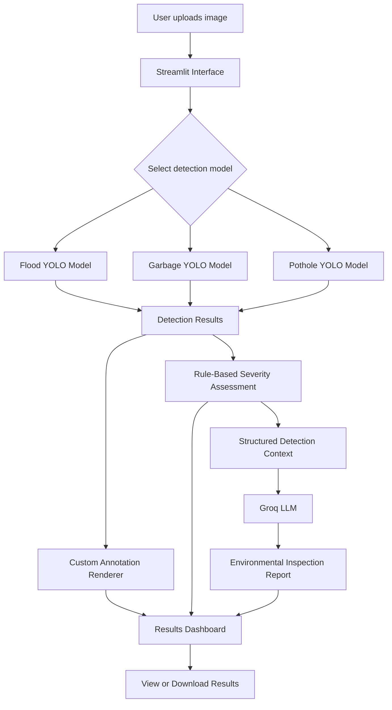

# 🌿 EcoInspect
### A Hybrid Computer Vision and Natural Language Processing Framework for Environmental Issue Detection, Severity Assessment, and Automated Report Generation

EcoInspect is an AI-powered environmental inspection application that combines **YOLO-based object detection, rule-based visual severity assessment, and Large Language Model (LLM)-assisted report generation** in a simple, interactive web interface.

The application analyzes uploaded images to detect environmental issues such as flooding, garbage accumulation, and road potholes. It presents annotated images, detection confidence scores, bounding-box information, preliminary visual severity estimates, and automatically generated inspection reports.

Built with Python and Streamlit, EcoInspect demonstrates how computer vision and natural language processing can be combined to transform image-based observations into structured, human-readable environmental inspection reports.

---

## 📌 Table of Contents

- [Overview](#-overview)
- [Key Features](#-key-features)
- [System Architecture](#-system-architecture)
- [Technology Stack](#-technology-stack)
- [Project Structure](#-project-structure)
- [How It Works](#-how-it-works)
- [Severity Assessment](#-severity-assessment)
- [AI-Powered Report Generation](#-ai-powered-report-generation)
- [Installation and Setup](#-installation-and-setup)
- [Configuration](#-configuration)
- [Running the Application](#-running-the-application)
- [Using EcoInspect](#-using-ecoinspect)
- [Output and Results](#-output-and-results)
- [Model Evaluation](#-model-evaluation)
- [Limitations](#-limitations)
- [Future Enhancements](#-future-enhancements)
- [Security and Responsible AI](#-security-and-responsible-ai)
- [Author](#-author)

---

## 🔍 Overview

Environmental issues such as road damage, waterlogging, and improper waste disposal require timely identification and assessment.

Traditional inspection processes can involve manual image review and the preparation of written reports. EcoInspect explores a more automated workflow by combining visual detection with structured reporting.

The system uses three separately trained YOLO models:

| Model | Purpose | Model File |
|---|---|---|
| Flood Detection | Detect flood-related visual regions | `flood_best.pt` |
| Garbage Detection | Detect visible garbage or waste | `garbage_best.pt` |
| Pothole Detection | Detect potholes in road images | `pothole_best.pt` |

The user selects the appropriate model for the uploaded image. The selected model performs inference, and the application presents its predictions alongside a preliminary rule-based severity estimate.

A Groq-hosted language model can then generate a concise environmental inspection report using the detection results and severity assessment.

**Project objective:** Demonstrate an integrated computer vision and NLP workflow for environmental issue detection and AI-assisted reporting.

## ✨ Key Features

### 1. Environmental Issue Detection

- Three independent YOLO object detection models.
- Support for flood, garbage, and pothole categories.
- Image upload through a Streamlit interface.
- Configurable detection confidence threshold.
- Object counts and individual confidence scores.
- Bounding-box coordinates and relative bounding-box area ratios.

### 2. Custom Detection Visualization

- Bounding boxes drawn over detected regions.
- Class labels and confidence values displayed on the image.
- Category-specific annotation colors.
- Annotated image preview.
- Option to download the annotated output.

### 3. Rule-Based Visual Severity Assessment

EcoInspect assigns a preliminary visual severity estimate using category-specific heuristic rules.

The assessment considers factors such as:

- Number of detected objects.
- Relative area of detected bounding boxes.
- Category-specific thresholds.

Possible outputs are Low, Medium, High, or Unavailable when no objects are detected.

These are heuristic visual estimates, not validated measurements of physical danger or environmental impact.

### 4. AI-Assisted Inspection Reports

The Groq API connects the detection pipeline to a language model that generates a readable inspection report.

Reports can include:

- Environmental issue category.
- Number of detected objects.
- Detection confidence scores.
- Bounding-box area ratios.
- Rule-based severity estimate and its explanation.
- Recommended next steps, including human verification.

The language model is instructed to use the supplied results rather than inventing locations, causes, physical dimensions, or environmental conditions.

### 5. Interactive Web Interface

The Streamlit application provides:

- Image upload and preview.
- Model selection.
- Confidence threshold controls.
- Detection result metrics.
- Annotated image display.
- Individual detection table.
- AI-generated report display.
- Download options for annotated images and reports.

---

## 🏗️ System Architecture

EcoInspect follows a modular pipeline in which each component performs a specific task.



### Component Responsibilities

| Component | Responsibility |
|---|---|
| `app.py` | Streamlit UI, image upload, model selection, result presentation, and downloads |
| `detector.py` | Model loading, YOLO inference, detection extraction, confidence filtering, and custom annotations |
| `severity.py` | Category-specific heuristic severity estimation |
| `summarizer.py` | Groq API integration and grounded report generation |
| `metrics.json` | Placeholder or stored model evaluation metadata; only verified values should be reported |
| `models/` | Local trained YOLO model weights |
| `assets/sample_images/` | Sample images for manual application testing |
| `results/` | Local generated outputs, excluded from Git by default |

## 🛠️ Technology Stack

| Technology | Role |
|---|---|
| Python | Core application language |
| Ultralytics YOLO | Object detection and inference |
| PyTorch | Deep learning framework used by the YOLO models |
| OpenCV | Bounding-box and annotation rendering |
| NumPy | Image array operations |
| Pillow | Image loading and conversion |
| Streamlit | Interactive web interface |
| Pandas | Detection table presentation |
| Groq API | Hosted language-model inference |
| python-dotenv | Environment variable configuration |

---

## 📁 Project Structure

The repository is organized as follows:

```text
EcoInspect/
│
├── app.py
├── detector.py
├── severity.py
├── summarizer.py
│
├── metrics.json
├── requirements.txt
├── README.md
├── .gitignore
│
├── models/
│   ├── flood_best.pt
│   ├── garbage_best.pt
│   └── pothole_best.pt
│
├── assets/
│   └── sample_images/
│
└── results/
```

Additional local development scripts may include `test_detector.py`, `test_models.py`, `test_severity.py`, and `test_summarizer.py`.

The trained `.pt` files are excluded from the Git repository by default. They must be supplied locally before running the application.

---

## ⚙️ How It Works

### Step 1: Image Upload

The user uploads an environmental image in JPG, JPEG, PNG, or WEBP format.

The image is converted to RGB before being passed to the selected model.

### Step 2: Model Selection

The user chooses the relevant environmental category:

- Flood
- Garbage
- Pothole

EcoInspect uses the corresponding trained model. It does not automatically determine the category of an arbitrary image.

### Step 3: Object Detection

The selected YOLO model performs inference and returns predicted bounding boxes, class labels, and confidence scores.

The confidence threshold controls which predictions are retained for display.

### Step 4: Annotation and Result Extraction

EcoInspect draws custom bounding boxes and labels on the original image.

For each retained detection, the system records:

- Predicted class.
- Confidence score.
- Bounding-box coordinates.
- Relative bounding-box area.

Inference time is also measured.

### Step 5: Severity Assessment

The detection results are passed to the rule-based severity module.

The module applies category-specific heuristic rules to produce a visual severity estimate and an explanation.

### Step 6: Report Generation

When requested, the report-generation module sends the detection context and severity assessment to the configured Groq model.

The generated report is displayed in the application and can be downloaded as a text file.

---

## 📊 Severity Assessment

EcoInspect currently uses rule-based severity heuristics rather than a separately trained severity prediction model.

The rules consider detection count and relative bounding-box area. Different thresholds are applied to different environmental categories.

The bounding-box area ratio is calculated as:

\[
\text{Area Ratio} =
\frac{(x_2-x_1)(y_2-y_1)}
{\text{Image Width}\times\text{Image Height}}
\]

Here, \(x_1,y_1,x_2,y_2\) represent the predicted bounding-box coordinates.

The result is a relative image-area measurement, not the physical area of the environmental issue.

### Interpretation

- **Low:** The detections satisfy the configured low-severity heuristic.
- **Medium:** The detections satisfy the configured medium-severity heuristic.
- **High:** The detections satisfy the configured high-severity heuristic.
- **Unavailable:** No detections were retained at the selected confidence threshold.

The thresholds are preliminary engineering choices. They should be calibrated against representative, human-labelled examples before the outputs are used for operational decisions.

A large bounding box does not necessarily imply a dangerous incident, and a lack of detections does not establish that a scene is safe.

---

## 📝 AI-Powered Report Generation

EcoInspect uses the Groq API to generate a concise environmental inspection report.

The model name is configurable through an environment variable, allowing the language model to be changed without rewriting the application.

The report generator receives structured information from the detection and severity modules rather than relying on an unrestricted description of the image.

### Example Report Structure

A report may contain:

1. Inspection heading and category.
2. Summary of detected objects.
3. Confidence values and bounding-box area ratios.
4. Rule-based visual severity estimate.
5. Recommended next steps.
6. A reminder to verify the findings before operational decisions.

The exact report depends on the image, model predictions, and configured language model.

Generated text is not an independent verification of the detector's predictions. Users should review reports before relying on them.

---

## 💻 Installation and Setup

### Prerequisites

Install the following before setting up EcoInspect:

- Python 3.9 or another Python version compatible with the pinned dependencies and installed PyTorch build.
- pip.
- Git.
- A Groq API key for AI report generation.
- The three trained YOLO model weight files.

### 1. Clone the Repository

```bash
git clone https://github.com/sanjanaspals1106/EcoInspect.git
cd EcoInspect
```

### 2. Create a Virtual Environment

On macOS or Linux:

```bash
python3 -m venv .venv
source .venv/bin/activate
```

On Windows PowerShell:

```powershell
python -m venv .venv
.venv\Scripts\Activate.ps1
```

### 3. Install Dependencies

```bash
python -m pip install --upgrade pip
pip install -r requirements.txt
```

### 4. Add Trained Model Weights

Create the local `models/` directory if it does not exist:

```bash
mkdir -p models
```

Place the three trained model files inside it:

```text
models/
├── flood_best.pt
├── garbage_best.pt
└── pothole_best.pt
```

The weight files are not included in the Git repository. Obtain them from the project owner or the location where the models were saved.

### 5. Configure the Groq API

Create a `.env` file in the repository root:

```text
GROQ_API_KEY=your_actual_groq_api_key
GROQ_MODEL=openai/gpt-oss-20b
```

Replace the API key placeholder with your own key. The configured model must be available to your Groq account.

Never commit `.env` to GitHub.

### 6. Launch EcoInspect

```bash
streamlit run app.py
```

Open the local URL printed in the terminal, usually:

`http://localhost:8501`

---

## 🔐 Configuration

EcoInspect uses environment variables for its language-model integration.

| Variable | Purpose |
|---|---|
| `GROQ_API_KEY` | Authenticates requests to the Groq API |
| `GROQ_MODEL` | Specifies the language model used for report generation |

The model weights are loaded from the local `models/` directory.

Detection confidence is configurable through the Streamlit interface.

---

## 🚀 Using EcoInspect

1. Launch the application.
2. Upload an environmental image.
3. Select Flood, Garbage, or Pothole in the sidebar.
4. Adjust the confidence threshold if necessary.
5. Click **Analyze Image**.
6. Review the annotated image and detection table.
7. Examine the preliminary severity estimate and its explanation.
8. Click **Generate Inspection Report**.
9. Review the generated narrative.
10. Download the annotated image or text report if required.

For meaningful results, choose images resembling the data on which the selected model was trained.

---

## 📈 Model Evaluation

EcoInspect supports displaying inference results, but its application output alone does not establish model accuracy.

A rigorous evaluation should use held-out validation or test data and report appropriate object-detection metrics, such as:

- Precision.
- Recall.
- Mean Average Precision at IoU 0.50 (`mAP@50`).
- Mean Average Precision over IoU thresholds 0.50–0.95 (`mAP@50–95`).

Metrics should be recorded separately for the flood, garbage, and pothole models when available.

**No model-performance scores are claimed in this README because verified validation values have not been supplied here.**

The inference time displayed by the application is an observed runtime measurement and should not be interpreted as a model accuracy metric.

Severity assessment should also be evaluated separately against human-labelled severity categories before its reliability is claimed.

---

## ⚠️ Limitations

- **Category selection:** The user must select the relevant model; automatic category selection is not implemented.
- **Detection accuracy:** Results depend on training data, image quality, model generalization, and the selected confidence threshold.
- **Bounding-box quality:** Predictions may cover only part of an object or include background.
- **Severity calibration:** Severity levels use preliminary heuristics and are not validated measures of physical risk.
- **Language-model reliability:** Generated reports can contain mistakes and require human review.
- **External API dependency:** Groq report generation requires network access and valid API credentials.
- **Model availability:** Trained model weights must be supplied separately.
- **Evaluation coverage:** Performance claims require documented validation or test results.

EcoInspect is intended as an AI-assisted inspection and reporting project, not a replacement for qualified environmental, road-safety, or emergency assessments.

---

## 🔮 Future Enhancements

Potential extensions include:

- Automatic selection or comparison of environmental detection models.
- Improved garbage and flood localization using better-labelled training data.
- Validation-based calibration of severity thresholds.
- Evaluation dashboards for per-model precision, recall, and mAP.
- Additional environmental issue categories.
- More robust handling of low-confidence and uncertain predictions.
- Structured PDF report generation.
- Historical inspection storage and trend analysis.
- Deployment with managed model-weight storage and secure secret configuration.
- Evaluation of generated reports for factual consistency and usefulness.

These are potential future improvements, not features claimed to be implemented in the current version.

---

## 🔒 Security and Responsible AI

- API keys must be stored in environment variables, not source code.
- `.env`, virtual environments, and large model weights should be excluded from version control unless there is a deliberate, secure distribution plan.
- Generated reports should be reviewed before they are used for operational decisions.
- Model confidence is not equivalent to the probability of physical danger.
- Severity labels must not be interpreted as validated risk assessments.
- Users should only upload images they are authorized to use.

---

## 👩‍💻 Author

**Sanjana Rama**

GitHub: [@sanjanaspals1106](https://github.com/sanjanaspals1106)

---

## 📄 License

No open-source license is specified at this time. Unless a license is added, standard copyright applies to the project's original code. Check the licenses of the underlying libraries, datasets, and pretrained components before redistributing them.
